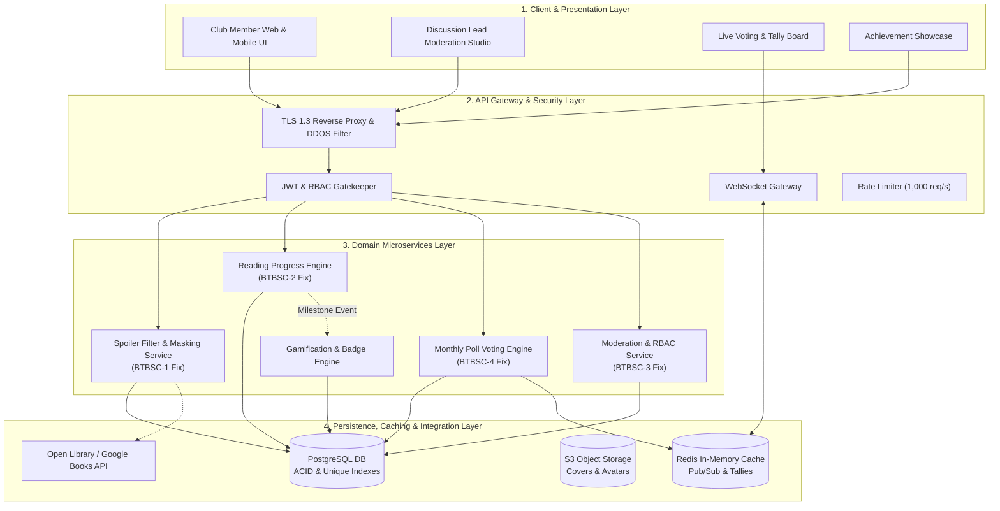

# Architectural Specification & Design Document

**System:** Book Club Reading Challenge & Discussion Portal  
**Problem Statement #55** | **Domain:** Media, Events & Community  
**Student:** Sushruth S | **SRN:** PES1UG24CS486  
**Institution:** PES University, Department of Computer Science & Engineering  

---

## 1. Architectural Style Selection & Justification

### 1.1 Selected Architectural Style: Layered Multi-Tier with Event-Driven Real-Time Extensions

The system employs a **4-Tier Layered Architecture** augmented with an **Event-Driven Pub/Sub messaging spine**:
1. **Tier 1: Client & Presentation Tier** (React / Next.js Web Application, Progressive Web App, Discussion Lead Studio)
2. **Tier 2: Edge Security & API Gateway Tier** (Nginx / Envoy Reverse Proxy, TLS 1.3 Termination, JWT RBAC Gatekeeper, WebSocket Push Gateway)
3. **Tier 3: Core Application & Domain Services Tier** (Spoiler Masking Service, Reading Progress Engine, Discussion Moderation Service, Monthly Poll Engine, Gamification Service)
4. **Tier 4: Persistence, Caching & Integration Tier** (PostgreSQL Relational DB, Redis In-Memory Cache, S3 Object Storage, External Book APIs)

### 1.2 Justification for Problem Statement #55

- **Strict Role Isolation (Club Member vs. Discussion Lead):** Tier 2 enforces cryptographic Role-Based Access Control (RBAC) at the edge, intercepting unauthorized moderation attempts before they reach the core domain (addressing **FR-003** and Jira Defect **BTBSC-3**).
- **Sub-200ms Polling Latency under Peak Concurrency (NFR-001):** The combination of Tier 4 Redis in-memory caching and Tier 2 WebSockets allows real-time tally broadcasts to thousands of concurrent users without querying the primary relational database.
- **ACID Integrity & Elimination of Duplicate Votes (FR-004, NFR-004):** The relational persistence layer enforces a composite unique constraint `UNIQUE(user_id, poll_id)` within atomic database transactions, preventing duplicate ballot submissions caused by rapid double-clicks or browser refreshes (remediating **BTBSC-4**).
- **Safe Spoiler Rendering & Search Sanitization (FR-001):** The architecture decouples client-side DOM blur masking from server-side search indexing pipelines, ensuring that search preview snippets are pre-sanitized before public delivery (remediating **BTBSC-1**).
- **Gamification Event Decoupling (FR-005):** Milestone badge awards execute asynchronously through internal event listeners, preventing reading progress updates from blocking on badge rendering.

---

## 2. Component Model & Subsystem Responsibilities

---

## 3. Core Subsystem Specifications

### 3.1 Spoiler Filter & Masking Subsystem
- **Purpose:** Masks `[spoiler]` comments until unmasked by member or chapter completion; pre-sanitizes search index snippets.
- **Interfaces:**
  - `POST /api/comments` — Accepts comment payload, identifies spoiler tokens, tags entity.
  - `GET /api/comments/{chapter_id}` — Returns comment payload with `is_spoiler=true` and CSS blur metadata.
  - `GET /api/search?q={term}` — Returns sanitized search snippets with spoiler text replaced with `[Spoiler Content Hidden]`.
- **Defect Resolution:** Fixes **BTBSC-1** by applying `sanitize_search_snippet()` filter during text tokenization.

### 3.2 Reading Progress & Goal Subsystem
- **Purpose:** Tracks personal daily/monthly reading targets; calculates completion percentage; updates reader streaks.
- **Interfaces:**
  - `POST /api/users/{id}/progress` — Submits `{book_id, pages_read, session_date}`.
  - `GET /api/users/{id}/dashboard` — Computes active goal progress, streak count, and remaining pages.
- **Validation Rules:** Validates that $0 < \text{pages\_read} \le \text{book.total\_pages} - \text{current\_page}$. Rejects negative values or zero (Fixes **BTBSC-2**).

### 3.3 Discussion Moderation Subsystem
- **Purpose:** Provides Discussion Leads with tools to pin prompts, close discussions, and delete inappropriate content.
- **Security Check:** Evaluates role claim in signed JWT (`role == 'DISCUSSION_LEAD'`). Non-leads receive `HTTP 403 Forbidden` (Fixes **BTBSC-3**).
- **Audit Logging:** Emits structured JSON events to `moderation_audit_logs` table for compliance.

### 3.4 Democratic Monthly Poll Subsystem
- **Purpose:** Conducts monthly book voting with duplicate vote prevention and sub-200ms real-time results.
- **Persistence Guarantees:**
  - Table `ballots`: Primary Key `(user_id, poll_id)`.
  - Transaction: `BEGIN TRANSACTION; INSERT INTO ballots ...; INCREMENT redis_tally; COMMIT;`.
  - If user attempts duplicate ballot submission, database raises unique constraint violation $\to$ API returns `HTTP 409 Conflict` (Fixes **BTBSC-4**).

---

## 4. Non-Functional Quality Attribute Realization

| Quality Attribute | Architectural Tactic / Design Choice | Metric Verified |
| :--- | :--- | :--- |
| **Performance** | In-memory Redis caching for aggregate vote tallies; connection pooling with PgBouncer. | P95 latency &lt; 180 ms under 1,000 concurrent requests. |
| **Security** | TLS 1.3 encryption on reverse proxy; Argon2id salted password hashing; AES-256 storage. | Zero plaintext credentials; Grade A+ SSL Labs rating. |
| **Availability** | Stateless application containers orchestrated with automated health check restarts; 99.9% uptime. | Downtime &le; 43.8 minutes/month. |
| **Integrity** | ACID database transactions with composite unique constraints `(user_id, poll_id)`. | 0 duplicate votes recorded during stress testing. |
| **Usability** | Responsive multi-breakpoint CSS; WCAG 2.1 AA compliant semantic HTML and ARIA labels. | 100% Axe accessibility score; fluid UI from 375px to 1920px. |
