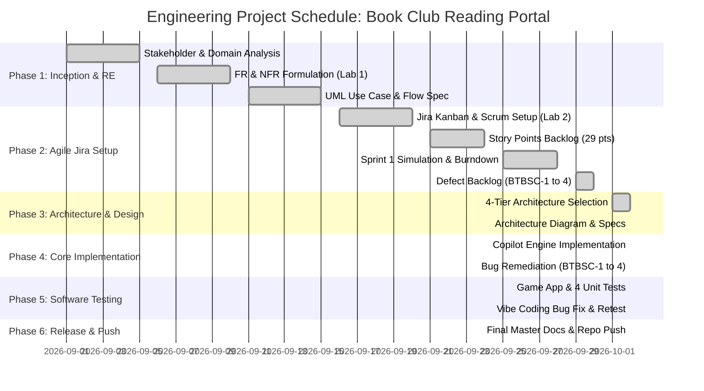

# Work Breakdown Structure (WBS) & Engineering Project Plan

**Project:** Book Club Reading Challenge & Discussion Portal (Problem Statement #55)  
**Student:** Sushruth S | **SRN:** PES1UG24CS486  
**Course:** Software Engineering Lab — Individual Project Assignment  
**Institution:** PES University, Department of Computer Science & Engineering  

---

## 1. Hierarchical Work Breakdown Structure (WBS)

```text
1.0 Book Club Reading Challenge & Discussion Portal
│
├── 1.1 Phase 1: Inception & Requirements Engineering (Lab 1)
│   ├── 1.1.1 Stakeholder Analysis & Domain Modeling (Problem Statement #55)
│   ├── 1.1.2 Functional Requirements Formalization (FR-001 to FR-008)
│   ├── 1.1.3 Non-Functional Requirements Specification (NFR-001 to NFR-006)
│   ├── 1.1.4 Bidirectional Requirements Traceability Matrix (RTM Table)
│   ├── 1.1.5 UML Use-Case Diagram Modeling («include», «extend» stereotypes)
│   └── 1.1.6 Use-Case Flow Specification (UC-04: Vote in Monthly Poll)
│
├── 1.2 Phase 2: Agile Project Planning & Jira Tool Setup (Lab 2)
│   ├── 1.2.1 Kanban Space Initialization & Workflow Board Setup (Kanban_BookClub)
│   ├── 1.2.2 Epic Definition & Requirement Hierarchy Association (4 Epics)
│   ├── 1.2.3 Scrum Workspace Configuration & Story Point Estimation (29 pts total)
│   ├── 1.2.4 Sprint 1 Timeboxing & Active Sprint Board Simulation
│   ├── 1.2.5 Sprint Burndown Chart Generation & Capacity Evaluation
│   └── 1.2.6 Defect Tracker Workspace & Backlog Logging (BTBSC-1 to BTBSC-4)
│
├── 1.3 Phase 3: Architectural Design & System Modeling (Lab 3)
│   ├── 1.3.1 Architectural Style Selection (4-Tier Layered + Event-Driven Pub/Sub)
│   ├── 1.3.2 Component Model & Interface Specification (REST & WebSockets)
│   ├── 1.3.3 High-Resolution Architecture Diagram Generation (PNG, SVG, Draw.io)
│   └── 1.3.4 Security & Performance Tactic Formalization (Sub-200ms latency, RBAC)
│
├── 1.4 Phase 4: Core Engineering & GitHub Copilot Implementation (Lab 3)
│   ├── 1.4.1 Copilot Prompt Engineering & Prompt Diary Documentation
│   ├── 1.4.2 Reading Progress & Goal Tracking Engine (FR-002, BTBSC-2 Fix)
│   ├── 1.4.3 Spoiler Content Filter & Search Sanitizer (FR-001, BTBSC-1 Fix)
│   ├── 1.4.4 Chapter Discussion Moderation & RBAC Enforcement (FR-003, BTBSC-3 Fix)
│   ├── 1.4.5 Democratic Monthly Poll Engine & Duplicate Voter Guard (FR-004, BTBSC-4 Fix)
│   └── 1.4.6 Gamification & Milestone Badge Award Listener (FR-005)
│
├── 1.5 Phase 5: Software Testing Practice & Vibe Coding Remediation (Lab 3)
│   ├── 1.5.1 Game Application Baseline Execution & Test Suite Setup
│   ├── 1.5.2 Automated Execution of 4 Unit Test Cases (Identifying Baseline Failure)
│   ├── 1.5.3 Vibe Coding Bug Localization & Prompt Crafting
│   ├── 1.5.4 Minimal Code Patch Application (game_patch.diff)
│   └── 1.5.5 Regression Retesting (Achieving 100% Pass Rate Across All 4 Tests)
│
└── 1.6 Phase 6: Release Engineering & Master Documentation
    ├── 1.6.1 Master Individual Project Assignment README.md
    ├── 1.6.2 Six-Folder Deliverable Structuring (1-RE through 6-Software_Testing_Tools)
    ├── 1.6.3 ReportLab Formatted Master PDF Deliverable Generation
    └── 1.6.4 Git Remote Synchronization & Final Repository Push
```

---

## 2. Work Package Dictionary & Story Point Allocations

| WP ID | Work Package / Task Title | Phase | Deliverable Artifact | Story Points (Fibonacci) | Predecessors | Status |
| :--- | :--- | :---: | :--- | :---: | :---: | :---: |
| **WP-1.1** | Domain & Stakeholder Analysis | 1 | Problem Statement #55 Charter | 2 | None | **Done** |
| **WP-1.2** | Requirements Engineering (FR & NFR) | 1 | `FR_and_NFR.md` | 3 | WP-1.1 | **Done** |
| **WP-1.3** | Requirements Traceability Matrix | 1 | `RTM_Table.md` | 3 | WP-1.2 | **Done** |
| **WP-1.4** | UML Use Case Diagram & Flow Spec | 1 | `Use_Case_Diagram.png`, Flow Doc | 5 | WP-1.2 | **Done** |
| **WP-2.1** | Jira Kanban & Scrum Setup | 2 | `Kanban_BookClub`, `Scrum_BookClub` | 3 | WP-1.3 | **Done** |
| **WP-2.2** | Backlog Estimation & Epics Linking | 2 | 29 Story Points Backlog | 3 | WP-2.1 | **Done** |
| **WP-2.3** | Sprint 1 Simulation & Burndown Chart | 2 | Burndown Chart, Post-Sprint Reflection | 5 | WP-2.2 | **Done** |
| **WP-2.4** | Defect Logging (BTBSC-1 to 4) | 2 | Bug Tracker Workspace & Reports | 3 | WP-2.3 | **Done** |
| **WP-3.1** | Layered Architecture Design | 3 | `Architecture_Specification.md` | 5 | WP-1.4 | **Done** |
| **WP-3.2** | Architecture Diagram Visual Export | 3 | `Architecture_Diagram.png`, `.drawio` | 3 | WP-3.1 | **Done** |
| **WP-4.1** | Copilot Prompting & Engine Scaffolding | 4 | `copilot_prompt_evidence.md` | 3 | WP-3.2 | **Done** |
| **WP-4.2** | Spoiler Filter & Search Sanitizer (FR-001) | 4 | `book_club_core_engine.py` (BTBSC-1) | 5 | WP-4.1 | **Done** |
| **WP-4.3** | Reading Progress Tracker (FR-002) | 4 | `book_club_core_engine.py` (BTBSC-2) | 5 | WP-4.1 | **Done** |
| **WP-4.4** | Moderation & RBAC Guard (FR-003) | 4 | `book_club_core_engine.py` (BTBSC-3) | 5 | WP-4.1 | **Done** |
| **WP-4.5** | Poll Engine & Duplicate Voter Check (FR-004) | 4 | `book_club_core_engine.py` (BTBSC-4) | 5 | WP-4.1 | **Done** |
| **WP-4.6** | Milestone Badge Engine (FR-005) | 4 | `book_club_core_engine.py` | 3 | WP-4.3 | **Done** |
| **WP-5.1** | Game Application & 4 Test Cases Setup | 5 | `game_application.py`, `test_game.py` | 3 | WP-4.5 | **Done** |
| **WP-5.2** | Vibe Coding Bug Localization & Patch | 5 | `game_patch.diff`, Vibe Guide | 3 | WP-5.1 | **Done** |
| **WP-5.3** | Retesting & Verification Suite Execution | 5 | 100% Green Test Suite Run | 2 | WP-5.2 | **Done** |
| **WP-6.1** | Master README & Folder Structuring | 6 | Root `README.md`, 6 Folders | 3 | WP-5.3 | **Done** |
| **WP-6.2** | Git Push & Remote Verification | 6 | GitHub Repo Release | 1 | WP-6.1 | **Done** |

---

## 3. Project Schedule & Milestone Gantt Chart



---

## 4. Risk Management & Mitigation Matrix

| Risk ID | Risk Description | Probability | Impact | Mitigation Strategy |
| :--- | :--- | :---: | :---: | :--- |
| **R-01** | Duplicate vote race conditions during poll deadline peaks. | Medium | **High** | Enforced composite primary key `(user_id, poll_id)` at relational layer and Redis atomic increments; validated with automated concurrency tests. |
| **R-02** | Accidental exposure of plot spoilers in search preview snippets. | High | **High** | Pre-sanitization pipeline in `SpoilerFilterEngine` strips `[spoiler]` blocks during search indexing before caching. |
| **R-03** | Unauthorized members manipulating moderation controls. | Low | **High** | Enforced cryptographic JWT RBAC inspection at the API Gateway before requests reach core service handlers. |
| **R-04** | Negative or out-of-bounds page inputs corrupting challenge metrics. | Medium | Medium | Server-side boundary checks ($0 < \text{pages} \le \text{remaining}$) throw explicit `ValueError`. |
